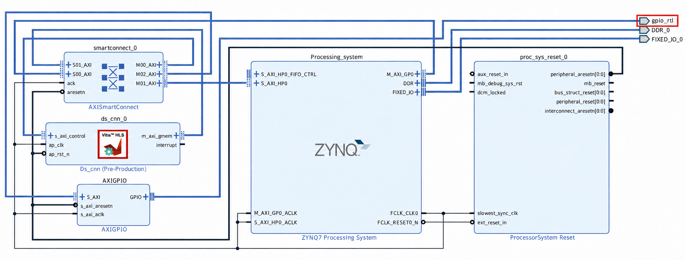

# Lightweight CNN for Embedded Vision
## From convolution to an efficient image classifier

This lab presents a practical workflow for training and deploying a custom-designed CNN on an FPGA to classify images into four classes: Full Cable, Right End, Left End, and No Cable. The images are organized into three datasets—training, validation, and test—and all three datasets are augmented. The images are then converted to grayscale and normalized before the CNN is trained, validated, and tested using TensorFlow’s Keras API. Loss curves and confusion matrices are used to assess its performance. Next, the trained model parameters are exported for accelerator implementation and verification in Vitis HLS. Finally, the generated RTL is integrated into a Vivado design, and the FPGA is programmed to verify the model’s predictions on hardware.

## Requirements

- One of the following options for the Python workflow:
  - Ubuntu 24.04 LTS installed directly on your computer; or
  - Ubuntu 24.04 LTS running through Windows Subsystem for Linux 2 (WSL 2); or
  - Python installed directly on Windows (requires Windows-specific commands to create and activate the virtual environment; package installation commands remain the same).
- Python 3.12 with `venv` and `pip`
- A Python virtual environment with the following packages installed:
  - TensorFlow (`tensorflow==2.21.0`)
  - NumPy (`numpy==2.5.4`)
  - OpenCV (`opencv-python==5.0.0.93`)
  - Matplotlib (`matplotlib==3.11.2`)
  - scikit-learn (`scikit-learn==1.9.1`)
  - Albumentations (`albumentations==2.0.8`)
  - pyserial (`pyserial==3.5`)
  - h5py (`h5py==3.14.0`)
- AMD/Xilinx development tools: Vitis, Vitis HLS, and Vivado (course instructions use **version 2020.2**)
- PYNQ-Z2 FPGA board with Zynq-7020 (`xc7z020clg400-1`)
- USB Type-A to Micro-USB Type-B data cable for FPGA programming, UART communication, and power
- Course datasets and source files from the course GitHub repository

**Note:** The Python installation instructions below are provided for Linux (Ubuntu), including Ubuntu running under WSL 2. For native Windows, use Windows-specific commands to install Python and create and activate the virtual environment. The `python -m pip` commands remain the same once the environment is activated.

## Disclaimer

The FPGA deployment instructions were prepared using Vitis, Vitis HLS, and Vivado **2020.2**. Newer versions may have different menus, project workflows, or settings. Adjust the steps as needed for your installed software versions.

Installation of the FPGA development tools and access to the FPGA board require separate setup.

## Instructions

### 1. Install Python prerequisites

Open an Ubuntu terminal. If you are using WSL 2 on Windows, open your Ubuntu terminal.

Install Python 3.12, `venv`, and `pip`:

```bash
sudo apt update
sudo apt install python3.12 python3.12-venv python3-pip
```

### 2. Create and activate a Python virtual environment

Open a terminal in your project folder and create a virtual environment named `cnn_env` using Python 3.12:

```bash
/usr/bin/python3.12 -m venv cnn_env
```

Activate the virtual environment:

```bash
source cnn_env/bin/activate
```

Verify the Python version:

```bash
python --version
```

The output should show `Python 3.12.x`. Keep the virtual environment activated when installing packages or running the Python scripts.

### 3. Install the required Python packages

With the `cnn_env` virtual environment activated, upgrade `pip`:

```bash
python -m pip install --upgrade pip
```

Install the required packages using the specified versions:

```bash
python -m pip install tensorflow==2.21.0 numpy==2.5.4 opencv-python==5.0.0.93 matplotlib==3.11.2 scikit-learn==1.9.1 albumentations==2.0.8 pyserial==3.5 h5py==3.14.0
```

The packages are used for:

- **TensorFlow:** building, training, and running the CNN
- **NumPy:** numerical arrays and operations
- **OpenCV (`opencv-python`):** image loading and preprocessing
- **Matplotlib:** plotting training curves and confusion matrices
- **scikit-learn:** evaluating classification performance
- **Albumentations:** augmenting the image datasets
- **pyserial:** sending test images to the FPGA and receiving predictions over UART
- **h5py:** saving and loading CNN models and weights in HDF5 (`.h5`) format

### 4. Verify the installed packages

List the installed packages and their versions:

```bash
python -m pip list
```

Check for dependency conflicts:

```bash
python -m pip check
```

### 5. Install Vitis, Vitis HLS, and Vivado

Download the **Unified Installer for version 2020.2** from the [AMD download page](https://www.amd.com/en/support/downloads/adaptive-socs-and-fpgas/development-tools/2020-2.html).

Run the installer and select **Vitis** as the installation product. Ensure that **Vitis, Vitis HLS, and Vivado** are included, along with device support for **Zynq-7000**.

Complete the installation. **Version 2020.2 is preferred** because it matches the tools used in this lab.

**Version note:** You may use a newer release, but menus, tool names, and project workflows may differ.

### 6. Clone the course repository

Clone the course repository once to obtain the datasets, source code, and presentation.

For Ubuntu, including Ubuntu running under WSL 2, install Git:

```bash
sudo apt update
sudo apt install git
```

For native Windows, install [Git for Windows](https://git-scm.com/download/win), then open Git Bash or PowerShell.

From your project folder, run:

```bash
git clone https://github.com/dbaniya/CNN_guest_lecture.git
cd CNN_guest_lecture
```

The files referenced in the following steps are available inside this cloned repository, so you do not need to download them individually.

Keep using the `cnn_env` virtual environment created in Step 2 when running Python scripts.

### 7. Locate the training dataset

Locate `new_training_data` in your cloned repository. If the dataset is compressed, extract it into your project folder.

Note the location of the `new_training_data` folder, as you will use this path in the data augmentation script.

### 8. Augment the training dataset (optional)

Open the data augmentation script in your cloned repository and set `DATA_ROOT` to the absolute path of your `new_training_data` folder:

```python
DATA_ROOT = Path("/absolute/path/to/new_training_data")
OUTPUT_ROOT = DATA_ROOT.parent / f"{DATA_ROOT.name}_aug"
```

Replace `/absolute/path/to/new_training_data` with the actual dataset path. `OUTPUT_ROOT` creates an output folder named `new_training_data_aug` alongside the original dataset folder.

Save and run the script with the `cnn_env` virtual environment activated. After it finishes, confirm that `new_training_data_aug` contains the augmented images.

### 9. Train the CNN

Open `train_cnn.py` in your cloned repository.

Set `ROOT` to the absolute path of the dataset folder. If you are using the original dataset, use:

```python
ROOT = Path("/absolute/path/to/new_training_data")
```

If you have augmented the dataset, use:

```python
ROOT = Path("/absolute/path/to/new_training_data_aug")
```

Replace the example path with the actual folder path, then save the script.

Open a terminal in the folder containing the script. With the `cnn_env` virtual environment activated, run:

```bash
python train_cnn.py
```

Wait for training and evaluation to complete. For **20 epochs**, approximate CPU training times based on the measured runs are:

| Dataset | Number of images | Approximate training time |
|---|---:|---:|
| Original dataset | 40,000 | 5–6 minutes |
| Augmented dataset | 840,000 | 1 hour 51 minutes |

Actual times depend on your hardware. Loading the dataset, evaluation, and saving outputs require additional time. Early stopping may finish training before all 20 epochs are completed.

### 10. Inspect the training outputs

After training finishes, open the output folder specified by `run_dir` in the training script.

The output folder should contain the following subfolders:

- `models`: saved trained models
- `plots`: training curves and confusion matrices
- `reports`: evaluation results and classification reports
- `weights_cstyle_folded`: exported C-style weights with batch normalization folded into the convolution parameters

Review the plots and reports to assess the model’s performance. Keep the `weights_cstyle_folded` folder for the Vitis HLS implementation.

### 11. Create a new Vitis HLS project

Open **Vitis HLS** and select **Create New Project**.

Enter a project name and choose a location for the project, then click **Next** to continue through the project wizard.

### 12. Set the top-level function

In the Vitis HLS project settings, set **Top Function** to `ds_cnn`.

This name must exactly match the top-level function in the provided C++ source code. Vitis HLS uses this function as the entry point for generating the CNN hardware accelerator.

### 13. Select the target FPGA part

During the Vitis HLS project setup, go to the Solution Configuration window and select the following FPGA part:

`xc7z020clg400-1`

This is the Zynq-7020 device used on the PYNQ-Z2 board.

### 14. Add the CNN source files

Locate the following files in your cloned repository and keep them together in one folder:

- `ds_cnn.cpp`
- `ds_cnn_weights.h`
- `ds_cnn_weights_data.h`

Open your Vitis HLS project and add all three files under **Source**.

### 15. Add the test bench file

Locate `ds_cnn_tb.cpp` in your cloned repository and ensure it is in the same folder as the three source files.

In your Vitis HLS project, add `ds_cnn_tb.cpp` under **Test Bench**. This file tests the CNN implementation using the test dataset.

### 16. Copy the exported model weights

Copy the `weights_cstyle_folded` folder generated during Python training into the folder containing:

- `ds_cnn.cpp`
- `ds_cnn_weights.h`
- `ds_cnn_weights_data.h`
- `ds_cnn_tb.cpp`

Keep the folder name `weights_cstyle_folded` unchanged and preserve all files inside it so the HLS source code can locate the exported weights.

### 17. Prepare the HLS test dataset

Locate `dwpw_cnn_testing_data_aug_txt` in your cloned repository. Copy it—or extract it if compressed—into the same folder as the HLS source files, test bench, and `weights_cstyle_folded` folder. If it is already there, no copy is needed.

Keep the name `dwpw_cnn_testing_data_aug_txt` unchanged so the test bench can locate the test data.

### 18. Run C synthesis and inspect the report

In Vitis HLS, select **Run C Synthesis**. Once synthesis finishes, open the **Synthesis Summary Report** and examine:

- **Performance estimates:** estimated clock period, latency, and initiation interval
- **Resource estimates:** BRAM, DSP, flip-flop (FF), and lookup table (LUT) usage

These estimates indicate the accelerator’s expected execution time and FPGA resource requirements.

### 19. Run C simulation and inspect the results

In Vitis HLS, select **Run C Simulation**. In the simulation settings, enable **Clean Build**, then run the simulation.

Once simulation finishes, inspect the resulting confusion matrices to assess the CNN’s classification performance on the test dataset.

### 20. Export the RTL as a Vivado IP

In Vitis HLS, select **Solution → Export RTL**.

In the **Export RTL** window:

- Set the export format to **Vivado IP (.zip)**.
- Select **VHDL** as the RTL language for evaluating the generated RTL.

Start the export and wait for it to finish.

### 21. Locate the exported IP package

After **Export RTL** finishes, open your Vitis HLS project’s solution folder, then open the `impl` folder.

Confirm that `export.zip` is present. This ZIP file contains the packaged CNN IP for use in Vivado.

### 22. Create the Vivado project and block design

Create a new project in **Vivado** and build the design shown below.



- Add the **Zynq7 Processing System** first, then run **Block Automation** to apply the board settings.
- Open **Tools → Settings → IP → Repository**, click **Add Repository**, and select the `impl/ip` folder inside your Vitis HLS solution directory.
- Confirm that the custom CNN IP appears in the **IP Catalog**, then add it and the remaining IP blocks. Connect them as shown in the figure above.
- The **`gpio_rtl`** port highlighted in red is an external GPIO connection. If you leave this GPIO interface internal instead of making it external, no XDC pin constraints are needed for it. An XDC file may still be required for other external ports or timing constraints.
- Open the **Address Editor** and confirm that the CNN IP’s AXI control interface has an assigned address. If it appears under **Unassigned**, click **Auto Assign Address**.

### 23. Set the top module in Vivado

In Vivado’s **Sources** window, expand **Design Sources**, right-click the appropriate top-level module for your design, and select **Set as Top**. For a block design, select its generated **HDL wrapper** as the top module.

### 24. Configure a GPIO for inference latency measurement (optional)

If you intend to measure inference latency using an oscilloscope or logic analyzer, make the GPIO interface external and add appropriate pin constraints to your Vivado `.xdc` file. **If you do not use this GPIO, do not make the interface external.**

**The following constraints are only an example.** Tailor the package pin and I/O standard to the **PYNQ-Z2 board** and your intended connection. Ensure the port name matches your HDL wrapper.

```tcl
set_property PACKAGE_PIN N14    [get_ports {gpio_rtl_tri_io[0]}]
set_property IOSTANDARD LVCMOS33 [get_ports {gpio_rtl_tri_io[0]}]
```

Drive the GPIO high before starting inference and low after inference completes. Measure the pulse duration to determine inference latency.

Apply the constraints before running implementation and generating the bitstream.

### 25. Validate the design and generate the bitstream

In Vivado, open the block design and select **Validate Design**. Resolve any reported errors before continuing.

From the **Flow Navigator**, run the following steps in order:

1. **Run Synthesis**
2. **Run Implementation**
3. **Generate Bitstream**

Wait for each step to complete successfully before proceeding to the next.

### 26. Export the hardware platform

Once the bitstream has been generated successfully, select **File → Export → Export Hardware** in Vivado.

In the export wizard, select **Include bitstream**, choose the output location, then click **Next** and **Finish**.

This creates an `.xsa` hardware platform file containing the hardware design and bitstream for use in Vitis.

### 27. Locate the exported XSA file

Open an Ubuntu terminal and run the following command to search your home folder and its subfolders for `.xsa` files:

```bash
find ~ -type f -name "*.xsa"
```

The output lists the full paths of matching files. Note the path of the `.xsa` file exported from your Vivado project, as you will select it when creating the platform project in Vitis.

### 28. Create a platform project in Vitis

Open **Vitis** and select **Create Platform Project**.

1. Enter a project name and click **Next**.
2. Select **Create a new platform from hardware (XSA)**.
3. Browse to and select the `.xsa` file exported from Vivado.
4. Set the operating system to **standalone**.
5. Select **ps7_cortexa9_0** as the processor.
6. Leave **Generate boot components** checked.
7. Click **Finish** to create the platform project.

### 29. Create an application project in Vitis

After creating and generating the platform project, select **File → New → Application Project**.

In the wizard, choose **Select a platform from repository**, select the platform you created in the previous step, and click **Next**.

### 30. Select the application domain

On the **Domain** screen, select the existing **standalone_domain** and click **Next**.

### 31. Select the Hello World template

On the **Templates** screen, select **Hello World** and click **Finish**.

This creates a starter bare-metal C application, which you will modify in the next step to control the CNN accelerator.

### 32. Replace the starter application code

Open the provided Hello World C source file in your cloned repository.

In Vitis, open the starter application’s `helloworld.c` file under **src**. Replace its contents with the code from the provided source file, then save the changes.

### 33. Build and run the application on the FPGA board

Connect the **PYNQ-Z2 board** to your computer using the USB Type-A to Micro-USB Type-B cable and power on the board.

In Vitis, build the application and resolve any build errors. Once the build completes successfully, select **Run → Run As → Launch on Hardware** to program the FPGA and run the application.

### 34. Prepare the test images and UART script

After programming the FPGA, locate `New_Testing_Data` and `send_images_uart.py` in your cloned repository. Keep the dataset folder and Python script together in one folder.

Open `send_images_uart.py` and set `ROOT` to the absolute path of the dataset directory containing the four class folders:

```python
ROOT = Path("/absolute/path/to/New_Testing_Data")
```

Replace `/absolute/path/to/New_Testing_Data` with the actual dataset path.

If desired, augment the test images using the same data augmentation script used earlier for the training and validation datasets. In that case, set `ROOT` in `send_images_uart.py` to the augmented test dataset folder.

Save the changes before running the script.

### 35. Configure the serial port and run the test script

Identify the `/dev/ttyUSB*` port connected to your board and set it as `SERIAL_PORT` in `send_images_uart.py`. For example:

```python
SERIAL_PORT = "/dev/ttyUSB1"
BAUD_RATE = 4000000
```

The UART baud rate is **4,000,000 baud (4 Mbaud)** and must match `UART_BAUD` in the Vitis C application.

Ensure no other serial terminal is using the selected port. Open a terminal in the folder containing the script. With the `cnn_env` virtual environment activated, run:

```bash
python send_images_uart.py
```

Observe the predictions, inference times, accuracy, and final confusion matrix printed in the terminal.
